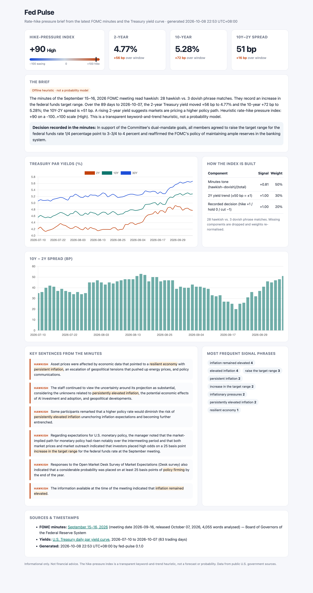

# fed-pulse

[](https://github.com/BrickerP/fed-pulse/actions/workflows/tests.yml)


**How much pressure is there on the Fed to hike?** `fed-pulse` is a small, dependency-free Python CLI that pulls the
latest **FOMC minutes** from federalreserve.gov and the last ~90 days of **U.S. Treasury par yields** (2Y / 10Y / 30Y),
then writes a plain-English brief and a single self-contained interactive HTML dashboard.



<sub>Screenshot of a real run on 2026-10-08 (September 15–16, 2026 minutes; Treasury data through 2026-10-07), offline heuristic mode.</sub>

## Quickstart

```bash
# run without installing (needs uv)
uvx --from git+https://github.com/BrickerP/fed-pulse fed-pulse --open

# or install from a clone
git clone https://github.com/BrickerP/fed-pulse && cd fed-pulse
pip install -e .
fed-pulse                      # writes ./fed-pulse.html and prints the brief
fed-pulse -o out/today.html --open
fed-pulse --json > report.json # machine-readable report on stdout
```

Optional: let Claude write the brief instead of the built-in heuristic.

```bash
export ANTHROPIC_API_KEY=...          # never commit this
fed-pulse --model claude-haiku-5-5    # default; also settable via FED_PULSE_MODEL
fed-pulse --no-llm                    # force the offline heuristic even if a key is set
```

| Flag | Default | Meaning |
| --- | --- | --- |
| `-o, --output PATH` | `fed-pulse.html` | Where to write the dashboard |
| `--json` | off | Print the full report as JSON (HTML only written if `-o` is also given) |
| `--days N` | `90` | Calendar days of yield history |
| `--model ID` | `$FED_PULSE_MODEL` or `claude-haiku-5-5` | Anthropic model used when `ANTHROPIC_API_KEY` is set |
| `--no-llm` | off | Always use the offline heuristic |
| `--timeout S` | `60` | Per-request timeout in seconds |
| `--open` | off | Open the dashboard in your browser |

## How it works

1. **Minutes.** Scrapes the [FOMC calendar](https://www.federalreserve.gov/monetarypolicy/fomccalendars.htm) for
   `fomcminutesYYYYMMDD.htm` links, takes the newest meeting (falling back to older ones if a page fails), and keeps only
   the substantive prose (headings, footnotes, votes and attendance are stripped). The policy decision sentence is extracted.
2. **Yields.** Downloads Treasury's official
   [daily par yield curve CSV](https://home.treasury.gov/resource-center/data-chart-center/interest-rates/TextView?type=daily_treasury_yield_curve);
   if Treasury is unreachable it falls back to FRED's keyless `DGS2` / `DGS10` / `DGS30` CSVs.
3. **Brief.**
   * **Offline heuristic (default)** — transparent and explainable, *not a probability model*. Three signals, each in [-1, 1]:
     * *Minutes tone* (50%): `(hawkish − dovish) / (hawkish + dovish)` phrase matches, using the regex lists in
       [`heuristic.py`](src/fed_pulse/heuristic.py) (e.g. "inflation remained elevated", "further policy firming" vs.
       "labor market had softened", "downside risks to employment").
     * *2Y yield trend* (30%): change in the policy-sensitive 2-year yield over the window; ±50 bp = ±1.
     * *Recorded decision* (20%): hike +1, hold 0, cut −1.

     The blend is scaled to a **−100…+100 hike-pressure index** (High ≥ 35, Elevated ≥ 15, Neutral, Low ≤ −15, Easing bias ≤ −35).
     Missing inputs are dropped and the weights re-normalised.
   * **Claude** — if `ANTHROPIC_API_KEY` is set, the minutes text, yield summary and heuristic stats are sent to the
     Anthropic Messages API and Claude writes a 150–220 word evidence-based brief. Failures fall back to the heuristic.
4. **Dashboard.** One HTML file with Chart.js (via CDN): yield curves, the 10Y−2Y spread, the brief, the index breakdown,
   the most hawkish/dovish sentences from the minutes with matched phrases highlighted, and data sources/timestamps.

The package uses only the Python standard library at runtime.

## Development

```bash
pip install -e ".[test]"
pytest -q        # offline: all network calls are replaced by fixtures in tests/fixtures
```

## Limitations

Keyword scans miss negation and nuance, minutes are released ~3 weeks after each meeting, and yield moves reflect much more
than Fed expectations. Treat the index as a conversation starter, not a signal.

## Disclaimer

This project is for informational and educational purposes only and is **not financial advice**. It is not affiliated
with the Federal Reserve, the U.S. Treasury, or Anthropic. Data comes from public U.S. government sources and may be
delayed or revised; verify anything important at the source.

## License

[MIT](LICENSE) © 2026 Yupeng Lu

## Work with me

I build production AI agents and data pipelines, especially for finance and markets. If you need something like this for your team, see [brickerp.github.io/hire](https://brickerp.github.io/hire/).
